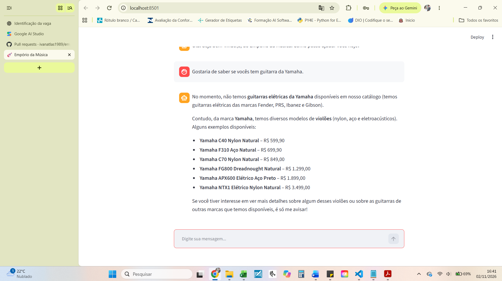
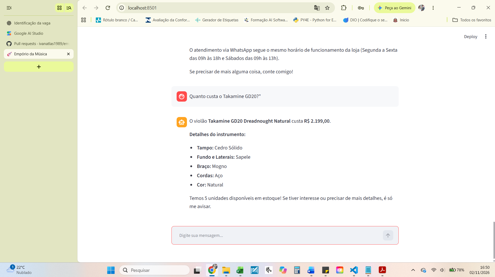
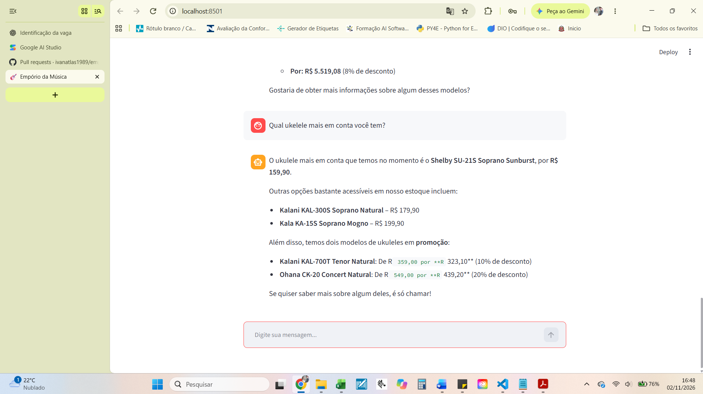

# Exemplo 01 — Consulta de Produtos

## Objetivo

Demonstrar a capacidade do agente de consultar o catálogo de produtos fornecido em CSV e responder a perguntas sobre instrumentos musicais, preços e disponibilidade.

## Cenário

O cliente deseja consultar informações sobre instrumentos musicais disponíveis na loja.

O agente utiliza funções Python para consultar os dados estruturados do catálogo, evitando depender exclusivamente do conhecimento do modelo de linguagem.

## Evidências da execução

### Consulta ao catálogo

### Consulta de preço — Takamine GD20

### Consulta de ukulele mais barato

## Implementação técnica

A consulta é realizada por meio do módulo `consultar_produtos.py`, utilizando os dados de `products.csv`.

O Gemini interpreta a solicitação do usuário e pode acionar a função de consulta para recuperar informações do catálogo.

A resposta é construída com base nos registros encontrados.

## Funcionalidades demonstradas

- Consulta de produtos por nome ou modelo.
- Recuperação de preços cadastrados.
- Consulta de disponibilidade.
- Interpretação de perguntas em linguagem natural.
- Integração entre Gemini e funções Python.
