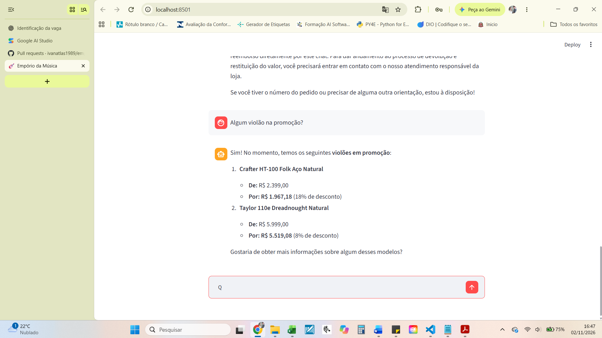

# Exemplo 02 — Promoções, Estoque e Memória Conversacional

## Objetivo

Demonstrar como o agente interpreta perguntas sobre promoções, consulta dados estruturados e mantém o contexto entre mensagens consecutivas.

## Conversa real

**Cliente:**
Gostaria de saber se vocês têm violão em promoção...

**Agente:**
Temos sim! Atualmente, estamos com dois modelos de violão em promoção:

1. **Crafter HT-100 Folk Aço Natural**
   - Preço original: R$ 2.399,00
   - Preço promocional: R$ 1.967,18
   - Desconto: 18%

2. **Taylor 110e Dreadnought Natural**
   - Preço original: R$ 5.999,00
   - Preço promocional: R$ 5.519,08
   - Desconto: 8%

**Cliente:**
Quantos em estoque?

**Agente:**
Atualmente, temos as seguintes quantidades em estoque para os modelos em promoção:

- Crafter HT-100 Folk Aço Natural: 3 unidades.
- Taylor 110e Dreadnought Natural: 4 unidades.

## Evidência visual

## Funcionamento técnico

O agente utiliza as funções Python de consulta para acessar os arquivos `promotions.csv` e `products.csv`.

Os descontos são aplicados sobre os preços cadastrados dos produtos.

Na pergunta "Quantos em estoque?", o usuário não informa novamente os nomes dos instrumentos.

O Gemini utiliza o histórico da conversa para interpretar que a pergunta se refere aos dois violões mencionados anteriormente.

## Validação dos resultados

| Produto        | Preço original | Desconto | Preço promocional | Estoque |
| -------------- | -------------: | -------: | ----------------: | ------: |
| Crafter HT-100 |    R$ 2.399,00 |      18% |       R$ 1.967,18 |       3 |
| Taylor 110e    |    R$ 5.999,00 |       8% |       R$ 5.519,08 |       4 |

Os valores foram conferidos com os arquivos CSV fornecidos no desafio.

## Funcionalidades demonstradas

- Consulta de promoções ativas.
- Recuperação de preços e descontos.
- Consulta de estoque.
- Memória de conversa.
- Interpretação contextual de perguntas.
- Respostas baseadas em dados estruturados.
