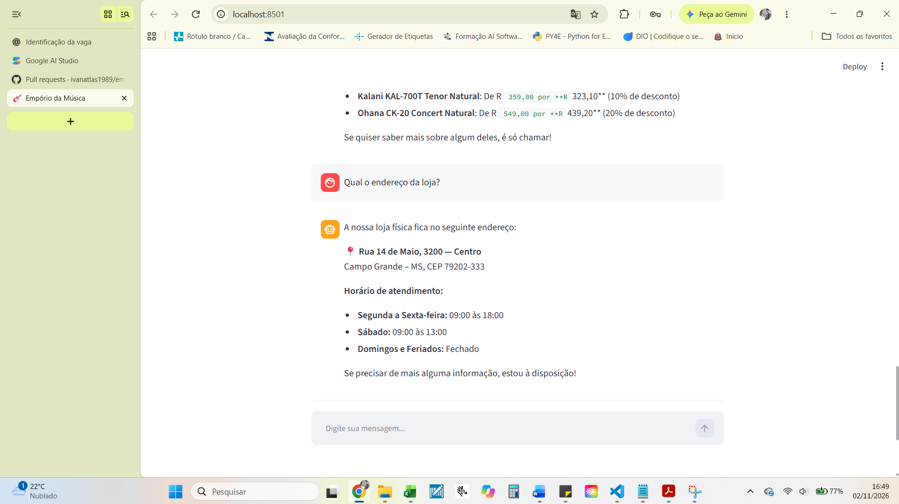
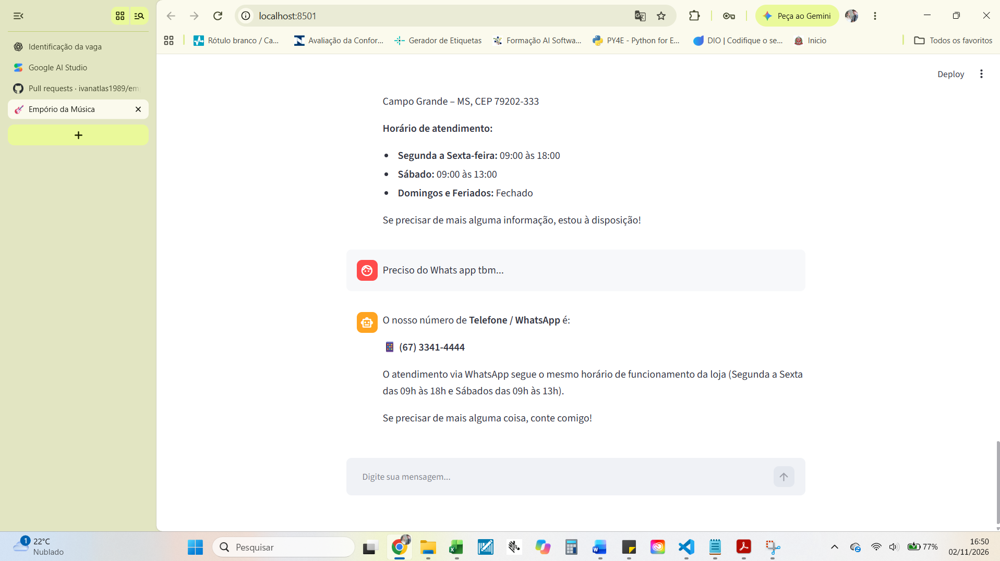

# Exemplo 03 — Informações da Loja e Canais de Atendimento

## Objetivo

Demonstrar a capacidade do agente de recuperar informações institucionais da Empório da Música, utilizando o manual de políticas e procedimentos fornecido no desafio.

## Conversa real

**Cliente:**
Endereço por favor

**Agente:**
Nosso endereço é:

**Rua 14 de Maio, 3200 — Centro**  
Campo Grande – MS | CEP: 79202-333

**Telefone / WhatsApp:** (67) 3341-4444

**Horário de funcionamento:**

- Segunda a sexta-feira: 09:00 às 18:00
- Sábado: 09:00 às 13:00
- Domingos e feriados: fechado

Ficaremos felizes em receber sua visita para testar os instrumentos!

## Evidências visuais

### Endereço e funcionamento

### Atendimento via WhatsApp

## Funcionamento técnico

As informações institucionais são recuperadas a partir do manual de políticas e procedimentos da loja.

O módulo `ler_politicas.py` organiza o conteúdo do PDF em trechos temáticos (chunks).

A ferramenta `consultar_politica()` utiliza embeddings e similaridade de cosseno para identificar os trechos relacionados à pergunta.

Os trechos recuperados são fornecidos ao Gemini, que apresenta as informações em linguagem natural.

## Funcionalidades demonstradas

- Interpretação de perguntas curtas.
- Recuperação semântica de informações institucionais.
- Consulta ao manual em PDF.
- Respostas em linguagem natural.
- Orientação sobre os canais oficiais de atendimento.

## Observação

O protótipo informa os canais de contato da loja, mas não envia mensagens pelo WhatsApp nem realiza atendimentos externos automaticamente.
