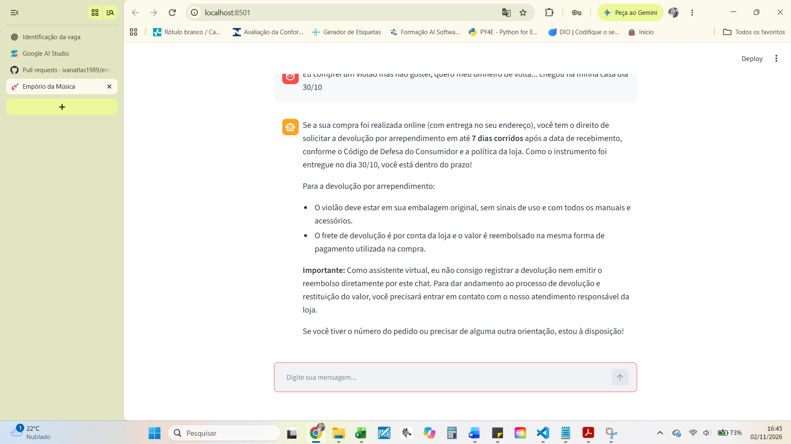
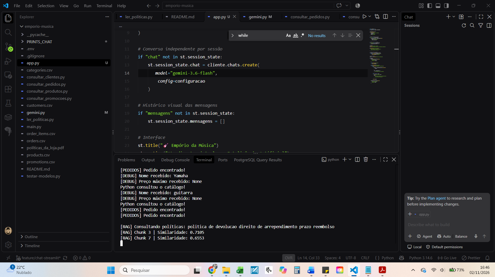
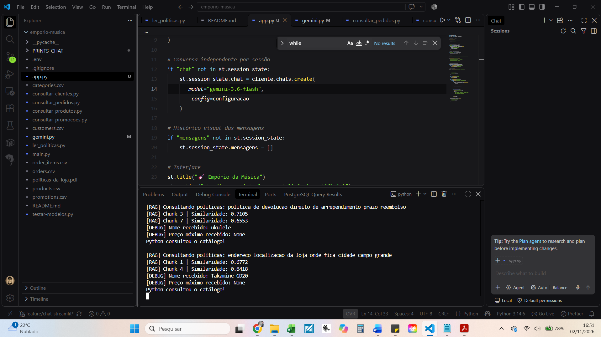

# Exemplo 04 — Interpretação Semântica e Política de Devolução

## Objetivo

Demonstrar como o agente interpreta uma solicitação de arrependimento de compra, recupera informações do manual de políticas e orienta o cliente sobre os procedimentos aplicáveis.

## Conversa real

**Cliente:**

Com relação ao meu violão que chegou dia 26/10/2026, comprei com vocês pela internet, mas não quero mais, não gostei. Quero meu dinheiro de volta.

**Agente:**

Como o seu violão foi comprado pela internet e entregue no dia **26/10/2026**, hoje (02/11/2026) você está dentro do prazo de **7 dias corridos** do direito de arrependimento previsto pelo Código de Defesa do Consumidor.

Como assistente virtual, **eu não tenho permissão para registrar devoluções, emitir reembolsos ou agendar coletas diretamente no sistema**.

Para dar andamento ao processo de devolução e ao reembolso, você precisa entrar em contato com a equipe de atendimento ao cliente pelos canais oficiais.

O agente também informou os canais de contato, as condições previstas para a devolução e a necessidade de encaminhar o procedimento à equipe responsável.

## Evidência visual

## Evidências do processamento

### Consultas ao backend e recuperação dos chunks

## Funcionamento técnico

O manual de políticas e procedimentos foi dividido em oito trechos temáticos (chunks), utilizando Python.

Cada trecho é convertido em uma representação vetorial com o modelo `gemini-embedding-001`.

Ao receber uma pergunta relacionada às políticas, o agente utiliza a ferramenta `consultar_politica()`.

A ferramenta transforma a pergunta em embedding, calcula sua similaridade de cosseno com os chunks e recupera os dois trechos com maior pontuação.

O Gemini utiliza os trechos recuperados para interpretar a solicitação e formular sua resposta.

## Interpretação da intenção

O cliente não utilizou necessariamente os termos técnicos "direito de arrependimento" ou "política de devolução".

Em vez disso, informou:

"Não quero mais, não gostei. Quero meu dinheiro de volta."

O agente relacionou semanticamente essa solicitação à política de devolução de compras realizadas pela internet.

Esse comportamento demonstra a importância da recuperação semântica em situações nas quais o usuário utiliza linguagem informal.

## Tratamento de datas

O projeto obtém a data atual utilizando Python e o fuso horário `America/Sao_Paulo`.

Neste teste:

- Data informada de recebimento: 26/10/2026.
- Data da consulta: 02/11/2026.
- Intervalo transcorrido: 7 dias corridos.

A resposta do agente considerou a consulta dentro do prazo de arrependimento, no limite de sete dias.

Esse comportamento deve ser entendido como resultado do teste, não como substituto da validação jurídica e operacional das regras aplicáveis.

## Limitações e segurança operacional

O agente não executa operações de devolução, cancelamento ou reembolso.

Em vez disso, orienta o cliente a utilizar os canais oficiais da loja.

Essa restrição foi estabelecida por meio das instruções de comportamento do agente e da ausência de ferramentas para executar essas operações.

## Funcionalidades demonstradas

- RAG sobre documentos PDF.
- Geração e comparação de embeddings.
- Recuperação de trechos por similaridade semântica.
- Interpretação de linguagem informal.
- Utilização da data atual.
- Orientação sobre prazos.
- Respeito aos limites operacionais do protótipo.
