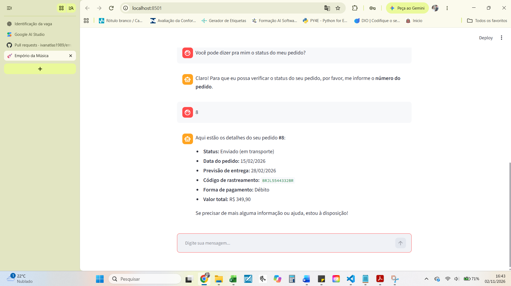
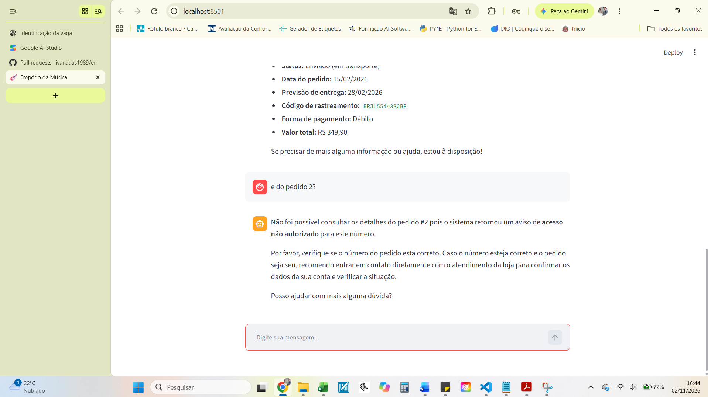

# Exemplo 05 — Segurança e Autorização de Pedidos

## Objetivo

Demonstrar como o agente protege informações de pedidos, permitindo consultas somente quando o pedido pertence ao cliente autenticado.

## Cenário

Para o desafio técnico, foi implementada uma simulação de autenticação.

O sistema considera o cliente de ID 2 como autenticado.

```python
cliente_logado = {
    "customer_id": "2",
    "autenticado": True
}
```

A identificação do cliente é definida previamente no backend, não sendo escolhida pelo modelo de linguagem.

## Teste 1 — Pedido autorizado

**Cliente:**

Gostaria de consultar o status do meu pedido número 8.

**Resultado:**

O sistema localiza o pedido 8, verifica que ele pertence ao cliente de ID 2 e permite o acesso às informações.

**Dados do pedido:**

- Número: 8
- Cliente proprietário: 2
- Status registrado: `shipped`
- Valor: R$ 349,90
- Código de rastreamento: BRJL5544332BR

### Evidência visual



## Teste 2 — Pedido não autorizado

**Cliente:**

Gostaria de consultar o pedido número 2.

**Resposta do agente:**

"Sinto muito, mas não consegui acessar os dados do pedido número 2. O sistema indica que não tenho autorização para consultar este pedido específico."

O pedido 2 existe, mas pertence ao cliente de ID 7.

Como o cliente autenticado possui ID 2, a consulta é bloqueada.

### Evidência visual



## Implementação técnica

O controle de autorização foi implementado no módulo `consultar_pedidos.py`.

A função `consultar_pedido_autorizado()` executa as seguintes verificações:

1. Confirma se o cliente está autenticado.
2. Consulta o pedido solicitado no arquivo `orders.csv`.
3. Verifica se o pedido foi encontrado.
4. Compara o `customer_id` do pedido com o do cliente autenticado.
5. Permite o acesso somente quando os identificadores correspondem.

Trecho da implementação:

```python
def consultar_pedido_autorizado(numero_pedido: str, cliente_logado: dict) -> dict:
    if not cliente_logado.get("autenticado"):
        return {"erro": "Cliente não autenticado"}

    pedido = consultar_pedido(numero_pedido)

    if "erro" in pedido:
        return pedido

    if pedido["customer_id"] != cliente_logado["customer_id"]:
        return {"erro": "Acesso não autorizado a este pedido"}

    pedido["itens"] = consultar_itens_pedido(numero_pedido)

    return pedido
```

## Decisão de arquitetura

A autorização não depende exclusivamente do prompt ou da interpretação do Gemini.

O modelo pode solicitar uma consulta, mas a função Python é responsável por decidir se os dados podem ser disponibilizados.

Essa separação reduz o risco de exposição de informações de terceiros por respostas inadequadas do modelo.

## Limitações

O protótipo utiliza autenticação simulada com identidade previamente definida.

Não existe login real, gerenciamento de sessões autenticadas ou integração com um provedor de identidade.

Para utilização em produção, seria necessário implementar autenticação real, gerenciamento seguro de sessões e testes adicionais de autorização.

## Funcionalidades demonstradas

- Consulta de pedidos em CSV.
- Simulação de cliente autenticado.
- Validação de propriedade do pedido.
- Bloqueio de acesso a dados de terceiros.
- Separação entre decisões de autorização e geração de linguagem natural.
- Tratamento de solicitações não autorizadas.
